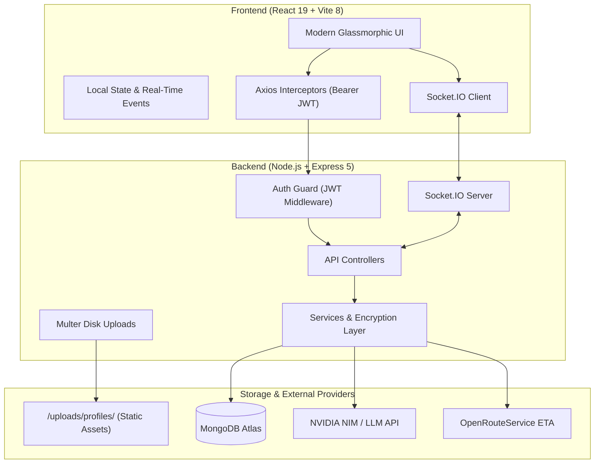

<div align="center">

  

  # FlowSync

  **Next-Generation Team Collaboration, Project Management & AI Worksuite**

  [](https://react.dev/)
  [](https://vitejs.dev/)
  [](https://nodejs.org/)
  [](https://expressjs.com/)
  [](https://www.mongodb.com/)
  [](https://socket.io/)

  <p align="center">
    FlowSync is an all-in-one modern workspace tailored for high-velocity teams. Featuring real-time messaging, multi-board task management, automated attendance & leave tracking, interactive calendar planning, and <b>Echo AI</b> — an embedded task-aware intelligence layer.
  </p>

</div>

---

## ⚡ Core Features

<table>
  <tr>
    <td width="50%" valign="top">
      <h3>📊 Unified Dashboard & Analytics</h3>
      <ul>
        <li><b>Live Progress Metrics</b>: Instant breakdown of completed, ongoing, and overdue tasks.</li>
        <li><b>Workforce Velocity</b>: Real-time visual progress meters tracking monthly work hours and attendance cycles.</li>
        <li><b>Dynamic Action Center</b>: Quick-action shortcuts and notification centers.</li>
      </ul>
    </td>
    <td width="50%" valign="top">
      <h3>🤖 Echo AI Workspace Assistant</h3>
      <ul>
        <li><b>Context-Aware Copilot</b>: Interacts directly with your team's live tasks and sprint deadlines.</li>
        <li><b>Intelligent Prioritization</b>: Automated risk assessments and dynamic task recommendations.</li>
        <li><b>Interactive Chat Drawer</b>: Instant conversational queries powered by external LLMs (NVIDIA NIM / OpenAI).</li>
      </ul>
    </td>
  </tr>
  <tr>
    <td width="50%" valign="top">
      <h3>💬 Real-Time Chat & Collaboration</h3>
      <ul>
        <li><b>Instant Direct Messaging</b>: Zero-latency messaging backed by Socket.IO.</li>
        <li><b>Custom Group Channels</b>: Multi-member group creation with stacked avatars and team badges.</li>
        <li><b>Smart Teammate Quick-Start</b>: Floating directory picker to discover and initiate conversations instantly.</li>
      </ul>
    </td>
    <td width="50%" valign="top">
      <h3>📅 Attendance & Leave Tracking</h3>
      <ul>
        <li><b>Cycle Monitoring</b>: Auto-calculated attendance intervals (25th to 25th cycle).</li>
        <li><b>Horizontal Calendar View</b>: Visual color-coded timeline tracking present days, half-days, and leaves.</li>
        <li><b>Leave Request Workflow</b>: Submit, filter, and cancel leave requests with real-time approvals.</li>
      </ul>
    </td>
  </tr>
  <tr>
    <td width="50%" valign="top">
      <h3>✅ Task & Sprint Management</h3>
      <ul>
        <li><b>Organized Kanban & Lists</b>: Drag, filter, and reassign tasks with priorities and due dates.</li>
        <li><b>Collaborator Assignments</b>: Assign tasks with live user avatar indicators and workload previews.</li>
        <li><b>File Attachments</b>: Attach notes and metadata directly to deliverables.</li>
      </ul>
    </td>
    <td width="50%" valign="top">
      <h3>⚙️ Profile & Workspace Customization</h3>
      <ul>
        <li><b>Profile Photo Uploads</b>: Direct multipart file upload via Multer with live reactive updates across UI.</li>
        <li><b>Dynamic Theme Engine</b>: Deep dark modes, sleek neon accents, and curated palettes.</li>
        <li><b>Security & Encryption</b>: Secure JWT auth and AES-256-CBC encrypted API key storage.</li>
      </ul>
    </td>
  </tr>
</table>

---

## 🏗️ System Architecture



---

## 📁 Repository Structure

```
flowsync/
├── backend/
│   ├── uploads/                      # User-uploaded profile media (static)
│   └── src/
│       ├── app.js                    # Express app configuration & static asset routes
│       ├── server.js                 # HTTP server, Socket.IO channels & DB bootstrap
│       ├── config/
│       │   └── db.js                 # MongoDB connection handler
│       ├── middleware/
│       │   ├── auth.middleware.js    # JWT authentication guard
│       │   └── upload.middleware.js  # Multer upload & image validator
│       ├── models/
│       │   ├── AISettings.js         # Encrypted AI provider configurations
│       │   ├── Attendance.js         # Daily attendance & work logs
│       │   ├── Chat.js               # Direct & group chat messages
│       │   ├── LeaveRequest.js       # Employee leave requests
│       │   ├── Task.js               # Tasks, sprints & assignments
│       │   ├── TeamName.js           # Workspace teams
│       │   └── User.js               # User accounts & profile references
│       ├── controllers/
│       │   ├── aiassistence.controller.js  # Echo AI insights & chat endpoints
│       │   ├── attendence.controller.js    # Attendance & leave management
│       │   ├── auth.controller.js          # Authentication (login/register)
│       │   ├── chat.controller.js          # Chat retrieval & history
│       │   ├── dashboard.controller.js     # Workspace metrics & summaries
│       │   ├── map.controller.js           # OpenRouteService ETA calculation
│       │   ├── task.controller.js          # Task CRUD operations
│       │   └── user.controller.js          # User profiles & avatar uploads
│       ├── routes/
│       │   ├── aiassistence.routes.js      # /api/ai/*
│       │   ├── attendence.routes.js        # /api/attendence/*
│       │   ├── auth.routes.js              # /api/auth/*
│       │   ├── chat.routes.js              # /api/chat/*
│       │   ├── dashboard.routs.js          # /api/dashboard/*
│       │   ├── map.route.js                # /api/eta
│       │   ├── task.routes.js              # /api/task/*
│       │   ├── teamname.route.js           # /api/teamname/*
│       │   └── user.routes.js              # /api/users/*
│       ├── services/
│       │   ├── aiassistence.services.js    # LLM queries & completion pipelines
│       │   ├── attendence.services.js      # Cycle logic & leave handlers
│       │   └── auth.services.js            # Password hashing & JWT generation
│       ├── prompts/
│       │   ├── aiChat.prompts.js           # Echo AI conversational prompts
│       │   └── taskAnalysis.prompts.js     # Structured task analysis prompts
│       └── utils/
│           ├── encryption.js               # AES-256-CBC encryption/decryption
│           └── jwt.js                      # JWT token signer
├── public/
│   ├── flowsync-icon.png             # Official FlowSync browser icon
│   └── favicon.svg
├── src/
│   ├── api/                          # Frontend Axios API client modules
│   │   ├── aiassistenceApi.js
│   │   ├── attendenceApi.js
│   │   ├── authApi.js
│   │   ├── axios.js
│   │   ├── chatApi.js
│   │   ├── dashboard.js
│   │   ├── taskApi.js
│   │   └── userApi.js
│   ├── assets/                       # UI illustrations, heroes & brand icons
│   ├── components/
│   │   ├── Calender/                 # Comprehensive multi-view Calendar
│   │   ├── layout/                   # Sidebar navigation & reactive status
│   │   └── ui/                       # Glass cards, LiquidEther, Skeletons, Modals, Toasts
│   ├── pages/
│   │   ├── AIAssist.jsx              # Echo AI interactive studio
│   │   ├── Attendance.jsx            # Attendance cycle, timeline & leave portal
│   │   ├── ChatScreen.jsx            # Team chat, group creation & DM channels
│   │   ├── Dashboard.jsx             # Real-time analytics & activity feed
│   │   ├── Login.jsx                 # User authentication portal
│   │   ├── Register.jsx              # New workspace onboarding
│   │   ├── Settings.jsx              # Profile, avatar upload & theme picker
│   │   ├── Tasks.jsx                 # Task board, project milestones & priorities
│   │   └── Team.jsx                  # Teammate directory & invitations
│   ├── styles/                       # Curated CSS styling systems & animations
│   ├── App.jsx                       # Client route definitions
│   └── main.jsx                      # App root mount
├── index.html                        # HTML entry point with FlowSync branding
└── package.json
```

---

## 📡 API Reference

### 🔐 Authentication (`/api/auth`)
| Method | Endpoint | Auth | Description |
|:---|:---|:---:|:---|
| `POST` | `/api/auth/register` | No | Create user account with name, username, email, team & password |
| `POST` | `/api/auth/login` | No | Authenticate user credentials and retrieve JWT token |

### 📋 Tasks (`/api/task`)
| Method | Endpoint | Auth | Description |
|:---|:---|:---:|:---|
| `GET` | `/api/task` | Yes | Retrieve workspace tasks filtered by team |
| `POST` | `/api/task` | Yes | Create a new task with project, priority & assignee |
| `PUT` | `/api/task/:id` | Yes | Update task status, deadline, or details |
| `DELETE` | `/api/task/:id` | Yes | Permanently remove a task |

### 🕒 Attendance & Leaves (`/api/attendence`)
| Method | Endpoint | Auth | Description |
|:---|:---|:---:|:---|
| `GET` | `/api/attendence/` | Yes | Fetch user attendance record and daily logs |
| `GET` | `/api/attendence/summary` | Yes | Summary of total work time, leaves taken, pending requests |
| `GET` | `/api/attendence/logs` | Yes | Detailed date-indexed logs for the horizontal calendar |
| `GET` | `/api/attendence/leave-options` | Yes | Available leave categories (Sick, Casual, Vacation) |
| `GET` | `/api/attendence/leave-requests` | Yes | Fetch leave history (All, Pending, Approved, Rejected) |
| `POST` | `/api/attendence/leave-request` | Yes | Submit new leave application |
| `PATCH` | `/api/attendence/cancel-leave/:id` | Yes | Cancel an existing leave request |

### 💬 Real-Time Messaging (`/api/chat`)
| Method | Endpoint | Auth | Description |
|:---|:---|:---:|:---|
| `GET` | `/api/chat/:userId` | Yes | Retrieve conversation history with a user or channel |

### 🤖 Echo AI Assistant (`/api/ai`)
| Method | Endpoint | Auth | Description |
|:---|:---|:---:|:---|
| `GET` | `/api/ai/assistence` | Yes | Generate structured task recommendations & workload analysis |
| `POST` | `/api/ai/aiChat` | Yes | Conversational query with task context injection |
| `POST` | `/api/ai/addmodel` | Yes | Save encrypted AI provider credentials & model choice |
| `GET` | `/api/ai/fetchmodels` | Yes | Retrieve active provider configuration metadata |

### 👤 Users & Profiles (`/api/users`)
| Method | Endpoint | Auth | Description |
|:---|:---|:---:|:---|
| `GET` | `/api/users` | Yes | List all users in team/workspace |
| `POST` | `/api/users/profile-picture` | Yes | Multipart image upload for user avatar |
| `PUT` | `/api/users/profile` | Yes | Update profile name, email, role, or bio |

---

## ⚡ Socket.IO Real-Time Events

| Event | Direction | Payload | Description |
|:---|:---:|:---|:---|
| `join` | Client → Server | `userId` | Register user session and online presence |
| `sendMessage` | Client → Server | `{ sender, receiver, message }` | Transmit instant direct message |
| `receiveMessage` | Server → Client | `ChatMessageObject` | Deliver message payload to active recipient |
| `disconnect` | Client → Server | — | Deregister socket session |

---

## 🚀 Getting Started

### Prerequisites
- **Node.js** v18.0.0 or higher
- **npm** v9.0.0 or higher
- **MongoDB** instance (Local or MongoDB Atlas cluster)

### 1. Clone & Configure Environment

```bash
git clone https://github.com/abhisheksureshnair/flowsync.git
cd flowsync
```

Create a `.env` file in the `backend/` directory:

```env
PORT=8080
MONGODB_URI=mongodb+srv://<username>:<password>@cluster.mongodb.net/flowsync?retryWrites=true&w=majority
JWT_SECRET=your_jwt_secret_key_here
ENCRYPTION_KEY=your_32_character_encryption_key_here
ORS_API_KEY=your_openrouteservice_api_key_here
```

### 2. Install Dependencies

```bash
# Install frontend dependencies
npm install

# Install backend dependencies
cd backend
npm install
cd ..
```

### 3. Start Development Servers

Run both servers concurrently or in separate terminals:

```bash
# Terminal 1: Backend
cd backend
npm run dev

# Terminal 2: Frontend
npm run dev
```

- **Frontend Application**: [http://localhost:5173](http://localhost:5173)
- **Backend API Server**: [http://localhost:8080](http://localhost:8080)

---

## 🎨 Theme Engine

FlowSync includes a customizable theme system accessible under **Settings > Appearance**:
- **FlowSync Dark** (Default obsidian aesthetic with electric blue accents)
- **Midnight Purple** (Deep violet background with glowing neon accents)
- **Cyberpunk Emerald** (Matrix-inspired high-contrast green aesthetic)
- **Minimal Slate** (Professional muted slate palette for focused workflows)

---

## 📄 License

This project is licensed under the [ISC License](LICENSE).
